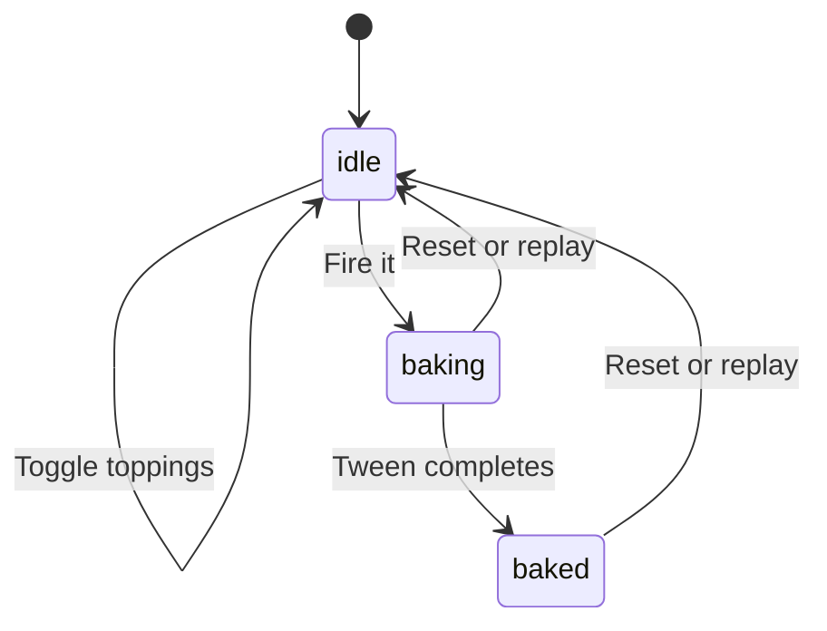

# હાલની pizza animationમાં શું કર્યું અને કેવી રીતે કામ કરે છે

આ file ZIPના actual code પર આધારિત implementation record છે. General suggestions માટે [workflow](03_ANIMATED_WEBSITE_WORKFLOW.md) અને known limits માટે [testing guide](04_TESTING_PERFORMANCE_AND_DEBUGGING.md) જુઓ.

## 1. શરૂઆતની implementationમાં મળેલી સમસ્યાઓ

| Finding | તેનો practical effect | કરેલું કામ |
| --- | --- | --- |
| `public/frames`ના 129 framesમાં reference websiteનું navigation અને headings પહેલેથી હતા. | Reactનું પોતાનું UI ઉપર મૂકતાં duplicate text અને navigation દેખાતાં. | Kitchen/chef માટે નવી cleaned 96-frame sequence તૈયાર કરી; live UI Reactમાં રાખ્યું. |
| જૂની sequence લગભગ પ્રથમ 4.3 seconds સુધી હતી. | આખો toss → prepared pizza → customizer flow પૂર્ણ થતો નહોતો. | Referenceના લગભગ 1.15–5.15 secondsના 4-second segmentમાંથી નવી sequence લીધી; પછી interactive stage જોડ્યો. |
| જૂનું `pizza-raw-base.png` ખરા top-down raw pizzaને બદલે chef sceneનો circular crop હતું. | Pizza overlayમાં chef/background દેખાતો અને spinning disc ખોટો લાગતો. | Transparent raw/cooked cheese pizza textures ઉમેર્યા; જૂની unused PNG compatibility માટે જાળવી. |
| Full-screen imageનું cover crop અને overlayની independent pixel position હતી. | Screen બદલાતાં pizza layer filmed sceneથી છૂટી પડતી અથવા કપાતી. | Canvas અને pizza overlayને એક જ source-coordinate mapping આપ્યું. |
| Receiptમાં fixed toppings અને $30 total હતાં. | Userએ બીજી selection કરી હોય તો પણ receipt બદલાતી નહોતી. | Selection અને price `App.jsx`માં રાખીને hero તથા receiptને એક જ state આપી. |
| Review controls સાથે cardsની visual arrangement બદલવાની જરૂર હતી; menu section અધૂરો હતો. | Interaction અને referenceનો page flow મેળ ખાતો નહોતો. | CSS offset-based fan, arrows/drag અને slice/pie menu ઉમેર્યું. |
| `overflow-x: hidden`થી body unintended scrolling ancestor બનતું હતું. | Sticky hero viewportમાં રહેવાને બદલે scroll થઈ જતું અને ખાલી વિસ્તાર દેખાતો. | Final CSSમાં `html, body` માટે `overflow-x: clip; overflow-y: visible` મૂક્યું. |

છેલ્લી સમસ્યાનું કારણ આ projectની ancestor chainમાં મળ્યું હતું. દરેક projectમાં blindly global overflow બદલી દેવું યોગ્ય fix નથી; પહેલા કયો element ખરેખર scroll કરે છે તે તપાસવો.

## 2. Architecture: કયો ભાગ શેના વડે બનેલો છે?

| Layer / behavior | Current technique | Source |
| --- | --- | --- |
| Page structure, controls, order state | React | `App.jsx`, components |
| Chef stretches/tosses dough | Pre-rendered WebP frames drawn on Canvas 2D | `HeroSection.jsx`, `public/chef/` |
| Scroll → story progress | GSAP tween with ScrollTrigger | `HeroSection.jsx` |
| Smooth wheel scrolling | Lenis synchronized to GSAP ticker | `App.jsx` |
| Sticky hero viewport | CSS `position: sticky` inside a tall section | `index.css` |
| Raw pizza, cooked pizza | Two transparent 600 × 600 WebP textures | `PizzaCustomizer.jsx` |
| Ingredient pieces | Positioned CSS spans with gradients/shapes | `PizzaCustomizer.jsx`, `index.css` |
| Ingredient entry | CSS keyframes, per-piece delay | `index.css` |
| Bake counter and completion | Timed GSAP tween | `HeroSection.jsx` |
| Pizza appearance during bake | CSS variable `--bake` crossfades base textures | `index.css` |
| Receipt appearance | GSAP entrance and scroll transforms | `ReceiptSection.jsx` |
| Delivery journey | Pinned ScrollTrigger with progress-based position/ETA | `DeliverySection.jsx` |
| Review carousel | React active index + CSS offset transforms | `ReviewsAndMenu.jsx` |

અહીં CSSનું oval/perspective effect છે; actual 3D pizza mesh નથી. Chefની movement browserમાં joints/physicsથી calculate થતી નથી.

## 3. Component map

| File | Responsibility અને ફેરફાર |
| --- | --- |
| `src/App.jsx` | Shared selection, price, bake status, reset key; Lenis lifecycle; whole page composition. |
| `src/components/HeroSection.jsx` | Frame loading/rendering, scroll playhead, captions, pizza placement, builder reveal, guided play, replay, baking. |
| `src/components/PizzaCustomizer.jsx` | `PizzaDisc` renderer તથા `CustomizerCard` controls. Hero અને receipt બંને renderer reuse કરે છે. |
| `src/components/Navbar.jsx` | Section navigation, build jump, home link, compact menu. |
| `src/components/ReceiptSection.jsx` | Current toppings અને derived total; pickup/delivery display toggle; call/back controls. |
| `src/components/DeliverySection.jsx` | Scooter journey, milestone bar, illustrative ETA, road alignment. |
| `src/components/ReviewsAndMenu.jsx` | Five-card fan, click/arrow/drag behavior, menu board. |
| `src/components/MarqueeStrip.jsx` | Existing repeated brand strip retained. |
| `src/components/Footer.jsx` | Existing footer/CTA retained; Appનો reset-to-top callback મળે છે. |
| `src/data/pizzaData.js` | Existing topping IDs, prices અને placement coordinates reused. |
| `src/index.css` | Original base styles સાથે final animation/responsive rules અને targeted overrides. |
| `src/App.css` | Older starter styles remain in the archive; the current App does not import this file. |
| `src/main.jsx` | Existing React StrictMode entry retained. |

નવો runtime dependency ઉમેરાયો નથી. Existing stack React, Vite, GSAP, Lenis, Tailwind અને Lucide પર જ કામ થયું છે. Exact resolved versions માટે supplied lockfile authoritative છે.

## 4. Scroll story: એક progress value

Heroમાં `progress.current.value` એટલે `p`, જે 0થી 1 સુધી જાય છે.

```js
// Current configuration, abbreviated for explanation:
gsap.to(progress.current, {
  value: 1,
  ease: 'none',
  scrollTrigger: {
    id: 'pizza-story',
    trigger: root,
    start: 'top top',
    end: 'bottom bottom',
    scrub: reducedMotion ? true : 0.32,
    invalidateOnRefresh: true,
  },
  onUpdate: draw,
});
```

Frameનો સમય અને page scrollનો સમય અલગ છે. User ધીમે scroll કરે તો ચાર secondsના source frames લાંબા સમય સુધી બતાવી શકાય છે; ઝડપથી scroll કરે તો ઓછા સમયમાં પસાર થાય છે.

| Story progress | Current visual / behavior |
| --- | --- |
| `0.000–0.035` | Initial HIGH TOSS intro fully visible. |
| `0.035–0.120` | Intro fades away. |
| `0.120–0.270` | Caption phase: NO ROLLING PIN. |
| `0.270–0.400` | Caption phase: STRETCHED THIN. |
| `0.400–0.510` | Caption phase: THEN IT FLIES. |
| `>= 0.510` | Caption phase selected as SAUCE. MOZZ.; its opacity separately fades out later. |
| `0.530–0.620` | Compact-layout kitchen height changes from 100% to 64%. |
| `0.540–0.590` | Story-copy opacity fades out. |
| `0.600–0.635` | Independent interactive pizza fades in. |
| `>= 0.620` | Canvas uses `kitchen-builder.webp` when decoded; chef sequence has reached its last frame. |
| `0.620–0.665` | Builder opacity ramps up. |
| `>= 0.640` | Builder gets visible CSS state via `data-building="true"`. |
| `0.760` | Build-a-pie and guided-play destination, leaving room to interact before the section ends. |
| `1.000` | End of sticky story range; following content continues normally. |

આ ranges codeના current numbers છે, source videoના exact shot timestamps નથી. Phase text thresholds અને frame progress અલગ mappings છે; captionsને વધુ ચોક્કસ shot સાથે match કરવા reference સામે અલગથી tune કરી શકાય.

### Frame selection

```js
const frame = Math.round(clamp(p / 0.62) * (96 - 1));
```

- `p = 0` → frame 0.
- `p = 0.31` → આશરે frame 48.
- `p >= 0.62` → frame 95 અથવા clean builder plate.
- Scroll પાછળ કરવાથી frame selection પણ પાછું જાય છે.

### Sticky distance

Current CSS: normal story `450svh`; compact layout `400svh`; reduced motion `260svh`. Sticky stage સામાન્ય રીતે `100svh` છે, સાથે minimum heights લાગુ પડે છે.

Minimum-height constraint લાગુ ન પડતું હોય તો nominal travel desktop પર `350svh` અને compact layout પર `300svh` જેટલું બને છે. Actual start/end measurements ScrollTrigger કરે છે; resize અને viewport height પ્રમાણે final distance બદલાય છે.

Hero માટે CSS sticky અને delivery માટે GSAP pin વપરાયા છે. એક જ hero પર બંને એકસાથે લગાડ્યા નથી.

## 5. Canvas rendering અને pizza alignment

Source coordinate system **1280 × 720** છે. Canvas backing pixels અને CSS pixels એક જ વસ્તુ નથી.

```text
dpr = min(devicePixelRatio, 1.5)
canvasWidth = sceneCSSWidth × dpr
canvasHeight = sceneCSSHeight × dpr

scale = max(canvasWidth / 1280, canvasHeight / 720)
x = (canvasWidth - 1280 × scale) × horizontalAnchor
y = (canvasHeight - 720 × scale) × 0.5
```

`max()` cover behavior આપે છે: scene ભરી જાય છે, પણ imageની બહારની બાજુ crop થઈ શકે છે.

Current pizza anchor source spaceમાં અંદાજે `(502, 190)` અને width `505` છે:

```text
pizzaLeftCSS = (x + 502 × scale) / dpr
pizzaTopCSS = (y + 190 × scale) / dpr
pizzaWidthCSS = 505 × scale / dpr
```

Overlayને `translate(-50%, -50%)`થી center કરવામાં આવે છે. Pizza wrappersમાં `rotate(-5deg) scaleY(0.353)` છે. આ flat round textureને sceneના oval angleમાં દેખાડે છે.

એક જ `x`, `y`, `scale` વાપરવાથી Canvas crop અને overlay position સાથે બદલાય છે. ફક્ત `left: 35%` અને fixed width મૂકવાથી અલગ aspect ratio પર alignment ખસી શકે છે.

`ResizeObserver` sceneનું size બદલાય ત્યારે ફરી draw કરે છે. Display DPR cap Canvasનું pixel workload ઓછું કરે છે; તે downloaded source framesની resolution અથવા cache memory ઘટાડતું નથી.

## 6. Frame loading

1. Six asynchronous workers ક્રમે frame URLs લે છે.
2. `new Image()` અને `decode()`થી image ready થાય પછી તેને ref arrayમાં રાખવામાં આવે છે.
3. દરેક completed attempt પછી progress label update થાય છે; failed attempts પણ completed countમાં આવે છે.
4. Target frame હજી decoded ન હોય તો ઉપલબ્ધ earlier frame શોધાય છે.
5. No decoded frame હોય ત્યારે CSS poster fallback દેખાવા માટે છે.
6. Failed requests માટે endમાં retry button ઉપલબ્ધ થાય છે.
7. Effect cleanupમાં disposed flag stale React updates અટકાવે છે.

આ implementation ultimately બધા 96 images referencesમાં રાખે છે. Six workersનો અર્થ maximum છ frames memoryમાં જ રહેશે એવો નથી. Actual requests cancel કરવા AbortController આધારિત fetch pipeline હાલ નથી. Builder-plate loading failureનો અલગ retry/error UI પણ હાલ નથી.

## 7. Shared order state

`App.jsx`માં:

| Value | Role |
| --- | --- |
| `selectedToppings` | Topping ID → boolean map; શરૂઆતમાં `{}`. |
| `status` | `idle`, `baking`, અથવા `baked`. |
| `resetKey` | Reset વખતે વધે છે; hero bake tween/counter reset માટે signal. |
| `totalPrice` | Derived value; અલગ mutable total state નથી. |

```js
const totalPrice = 21 + TOPPINGS.reduce(
  (sum, item) => sum + (selectedToppings[item.id] ? item.price : 0),
  0,
);
```

| Item | Additional price | Piece count from coordinate data |
| --- | --- | --- |
| Cheese base | $21 | Base texture |
| Pepperoni | $3 | 7 |
| Fresh basil | $2 | 5 |
| Fresh mozzarella | $3 | 4 |
| Chili flakes | $1 | 5 groups; each group has extra CSS flecks |
| All four selected | $30 total | All layers |

`PizzaDisc`માં selected group mount થતાં piecesની CSS entry animation થાય છે. Group remove કરતાં તે unmount થાય છે; outgoing physical flight animation હાલ નથી. Positions અને rotations data-driven છે, runtime random scatter નથી.

Receiptમાં બીજી independently hardcoded list અથવા total નથી. તે same selection, derived price અને same `PizzaDisc` component વાંચે છે. Toppings visually move કરે એટલે price બદલાય એવું નથી; user selection state બદલાય એટલે visual અને price બંને બદલાય છે.

## 8. Baking: user actionથી ચાલતો time-based flow



| Setting | Current value |
| --- | --- |
| Temperature range | 0 → 899°F |
| Normal duration | 3.4 seconds |
| Reduced-motion duration | 0.1 seconds |
| Tween easing | `power2.inOut` |
| Normal pizza spin | One CSS turn per 32 seconds |
| Baking pizza spin | One CSS turn per 1.25 seconds |
| Crossfade driver | `--bake = temperature / 899` |

`fire()` duplicate callને status checkથી અટકાવે છે અને guided playback stop કરે છે. Baking તથા baked stateમાં ingredient controls disabled છે. Heat progress raw textureને fade out અને cooked textureને fade in કરે છે. Toppings અલગ layerમાં હોવાથી same selected pieces જ રહે છે.

CSS glow/flicker visual atmosphere આપે છે; real heat simulation, cheese deformation અથવા fluid dynamics નથી. 3.4-second presentation actual baking durationનો simulation છે.

**Scroll અને baking અલગ clocks છે:** chef sequence reverse થઈ શકે છે, પણ scroll પાછળ કરવાથી selection કે completed bake undo થતું નથી. Reset/replayથી order state clear થાય છે. User bake કર્યા વગર receipt સુધી scroll કરી શકે છે; હાલ forced checkout sequence નથી.

## 9. Controls અને cleanup

| Control | Current behavior |
| --- | --- |
| Build a pie / Make it yours / back-to-pie | `pizza:build` event; heroના 76% point સુધી scroll. |
| Play the toss | GSAP playhead scroll position ચલાવે છે; destination 76%. |
| Pause | Guided tween kill થાય છે. |
| Wheel / touch outside story controls | Guided playback cancel થાય છે. |
| Replay | Bake/tour tween stop, shared order reset, scroll to top. |
| Make another pie | Shared order reset; user builderમાં રહી શકે છે. |
| Order up | Receipt section સુધી scroll. |
| Footer CTA | Parent reset plus scroll to top. |
| Home logo | Top સુધી scroll; તે પોતે order reset કરતું નથી. |

Guided duration `max(3, (0.76 - start) × 16)` seconds છે. Already customization areaમાં હોય તો guided start 0થી ફરી શરૂ થાય છે; guided play અને Replay સંપૂર્ણ એકસરખાં reset controls નથી.

Lenis માટે `autoRaf:false`; એક જ GSAP ticker callback `lenis.raf(time × 1000)` ચલાવે છે. Lenis scroll event ScrollTrigger update કરે છે. Fonts ready / load પછી measurements refresh થાય છે.

Cleanupમાં ticker callback remove, Lenis destroy, local ScrollTrigger/tweens kill, ResizeObserver disconnect, અને event listeners remove થાય છે. Per-frame values refs/CSSમાં રાખ્યા છે; phase બદલાય ત્યારે React update થાય છે. Temperature state baking દરમ્યાન વારંવાર update થાય છે—તેને throttle કરવું future optimization હોઈ શકે છે.

## 10. Following sections

### Receipt

Pizza scrollમાં `y:-110`, rotation `-36`, scale `0.7`થી આવતી entrance ધરાવે છે; receipt content staggerથી reveal થાય છે. Heroમાંથી એ જ DOM element physically receiptમાં travel કરતું નથી—**same renderer અને stateનું બીજું instance** છે. Seamless single-object morph હાલ implement નથી.

### Delivery

Configured pin range `+=160%`; configured scrub `0.65`. Scooter position actual `onUpdate` callbackમાં `self.progress`થી આવે છે:

```text
width < 700px: left% = -5 + 62 × p    → -5% to 57%
otherwise:    left% = -5 + 78 × p    → -5% to 73%
```

ETA steps: `<.25 → 14`, `<.55 → 11`, `<.85 → 7`, પછી `2` minutes. Progress bar minimum 5% બતાવે છે. Body bounce `y:-4`, duration `.26`, repeat/yoyo છે. PNGના transparent marginsને ધ્યાનમાં રાખીને road position CSSમાં adjust થયું છે.

આ demo journey છે; GPS, courier API અથવા real order-status subscription નથી. `scrub` configuration હોવા છતાં callbackથી કરેલા direct style writes tween playhead જેવી smoothing આપશે એવું assume ન કરવું.

### Reviews and menu

Active index initially 2. Five cardsને active cardથી relative offset `-2…2` મળે છે.

| Layout | Horizontal offset per card | Vertical offset per absolute index | Rotation per index |
| --- | --- | --- | --- |
| Desktop | 215px | 48px | 19° |
| Compact | 110px | 35px | 22° |

Pointer movement 35pxથી વધારે હોય તો previous/next switch થાય છે. Drag પછી click selection overwrite ન કરે તે માટે dragged flag છે. Vertical page scrolling માટે `touch-action: pan-y` છે. Entrance animation fan wrapper પર છે, જેથી GSAPની inline transform CSS card transformsને freeze ન કરે.

Menu price table તથા CTA actual DOM UI છે; payment/cart backend નથી.

## 11. Responsive values અને accessibility

- Compact CSS rules `max-width:900px` પર apply થાય છે.
- Canvas focus condition JavaScriptમાં `<900` છે; scooter movement condition `<700` છે. Exactly 900px/700px આસપાસ boundary QA કરવી જરૂરી છે.
- Compact heroમાં kitchen 100%થી 64% થાય છે; builder bottom areaમાં આવે છે; card max-width 460px છે.
- Horizontal anchor compact layoutમાં `.58`થી `.32` તરફ બદલાય છે જેથી focus chefથી pizza તરફ જાય.
- Compact sticky stage minimum height 630px; normal stage minimum 570px. Very short screensમાં આ viewport કરતાં ઊંચું થઈ શકે છે.
- Keyboard buttons, pressed states, image labels, skip-to-menu link અને focus styling છે.
- Reduced-motion CSS loops/transitions બંધ કરે છે; Lenis smooth wheel બંધ અને bake duration ઓછી થાય છે. Scroll-driven frame changes હજી રહે છે. Fully static reduced-motion experience હાલ implement નથી.

## 12. Fidelity boundaries

Current version reference-inspired interactive reconstruction છે, pixel-perfect re-creation અથવા new editable 3D scene નથી. Source video 1280 × 720 છે; bigger Canvas તેને true 4K detail આપતું નથી. Caption cleanup, compressed footage, final generated kitchen plate અને CSS ingredient shapesને કારણે differences રહી શકે છે. Final plate પર switch direct છે; advanced matched-camera handover future refinement છે.

Actual files, asset sizes, testing gaps અને આગળ શું profile કરવું તે [testing document](04_TESTING_PERFORMANCE_AND_DEBUGGING.md)માં આપ્યું છે.
